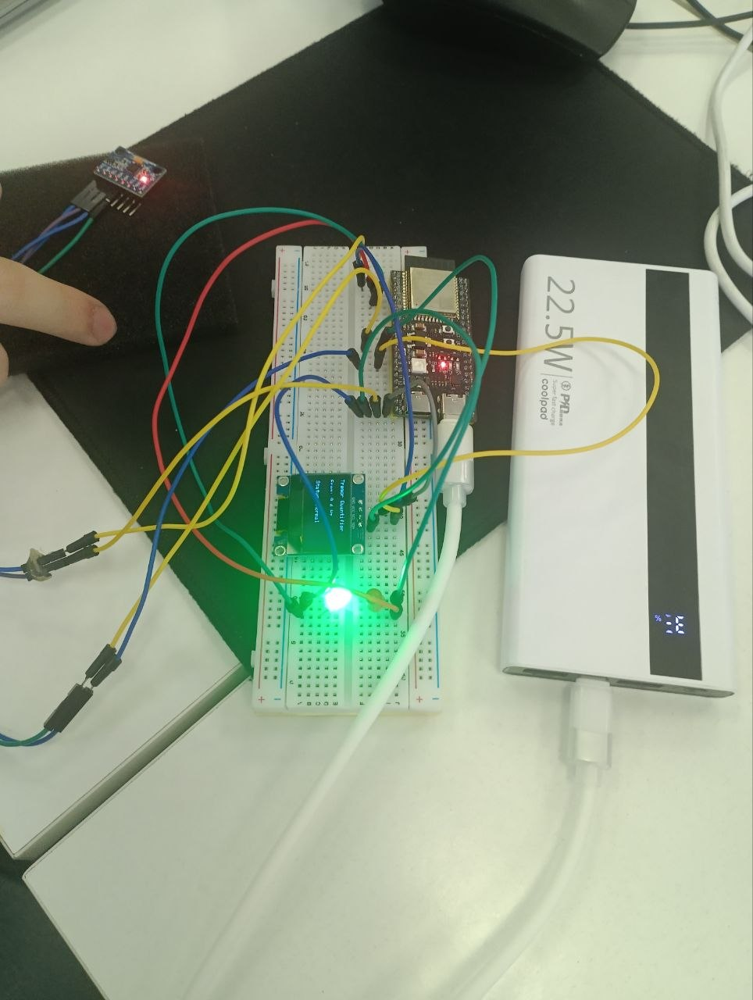

# Parkinsonian Tremor Quantifier

An embedded real-time Digital Signal Processing (DSP) system built on the **ESP32-S3** to detect and quantify Parkinsonian resting tremors (`4.0 – 6.0 Hz`) using 3-axis accelerometer telemetry and Fast Fourier Transform (FFT) spectral analysis.

---

## Hardware Prototype



*Autonomous ESP32-S3 prototype powered via USB-C power bank: displaying `Status: Normal` (`0.0 Hz`) on the SSD1306 OLED with the green status LED active and the tethered IMU sensor ready for oscillation testing.*

---

## Wokwi Online Simulation

You can test and run the virtual circuit directly in your browser without physical hardware:

🔗 **[Launch Interactive Wokwi Simulation](https://wokwi.com/projects/478310285761660929)**


*Virtual circuit simulation running `code/wokwi_simulation/sketch.ino` with real-time FFT peak detection and LED/OLED feedback.*

---

## Key Features

* **Real-Time 50 Hz Sampling:** Deterministic `20,000 µs` microsecond timer loop capturing 128 samples per analysis window (`2.56 s`).
* **3D Vector & DC Offset Removal:** Computes total acceleration magnitude ($\sqrt{a_x^2 + a_y^2 + a_z^2}$) independent of sensor orientation and subtracts static gravity.
* **Spectral Analysis (FFT):** Applies a **Hamming Window** to minimize spectral leakage, followed by a 128-point FFT and parabolic peak interpolation for sub-bin frequency accuracy.
* **Noise Floor Filtering:** Suppresses ambient micro-vibrations below `0.15 m/s²` (`0.0 Hz` baseline) and applies Exponential Moving Average (EMA) smoothing to stabilize readings.
* **Dual Visual Feedback:** Real-time frequency readout (`Hz`) and status classification on a `128×64` OLED display paired with Red/Green LED alerts.

---

## Repository Structure

```text
Parkinsonian-Tremor-Quantifier/
├── code/
│   ├── esp32s3_hardware/
│   │   └── tremor_quantifier_hw.ino   # Production firmware for physical ESP32-S3 hardware
│   └── wokwi_simulation/
│       ├── diagram.json               # Wokwi circuit diagram
│       └── sketch.ino                 # Simulation firmware for Wokwi
├── docs/
│   ├── image.png                      # Wokwi circuit simulation screenshot
│   ├── prototype.jpg                  # Assembled hardware prototype photo
│   └── schematics.md                  # Bill of Materials, pinouts, and block diagram
├── .gitignore
├── LICENSE
└── README.md
```

---

## Hardware Wiring (ESP32-S3-WROOM-1)

| Component | Module Pin | ESP32-S3 Pin | Function |
| :--- | :--- | :--- | :--- |
| **MPU-6050 / 6500** | `VCC` / `GND` | `3V3` / `GND` | 3.3V power supply |
| **MPU-6050 / 6500** | `SDA` / `SCL` | `GPIO 8` / `GPIO 9` | Shared I2C bus (`100 kHz`, addr `0x68`) |
| **SSD1306 OLED** | `VCC` / `GND` | `3V3` / `GND` | 3.3V power supply |
| **SSD1306 OLED** | `SDA` / `SCL` | `GPIO 8` / `GPIO 9` | Shared I2C bus (`100 kHz`, addr `0x3C`) |
| **Red LED** | Anode (`+`) / Cathode (`-`) | `GPIO 4` / `GND` | Tremor alert (`4.0 – 6.0 Hz`) |
| **Green LED** | Anode (`+`) / Cathode (`-`) | `GPIO 5` / `GND` | Normal baseline indicator |

*(Full wiring diagrams and Wokwi pin mappings are documented in [`docs/schematics.md`](docs/schematics.md).)*

---

## Firmware Versions

* **`code/esp32s3_hardware/tremor_quantifier_hw.ino`** — Designed for the physical ESP32-S3 prototype. Communicates directly with IMU registers over I2C (`100 kHz`) for compatibility with both MPU-6050 and MPU-6500 modules, computes 3D acceleration magnitude, removes static gravity, and applies noise-threshold filtering.
* **`code/wokwi_simulation/sketch.ino`** — Adapted for virtual circuit testing in Wokwi using standard ESP32 I2C pins (`GPIO 21` / `GPIO 22`).

---

## Required Libraries (Arduino IDE)

1. **`arduinoFFT`** (v2.x) by Enrique Condes
2. **`Adafruit SSD1306`** by Adafruit
3. **`Adafruit GFX Library`** by Adafruit
4. **`Adafruit MPU6050`** *(required only for `wokwi_simulation/sketch.ino`)*

### Arduino IDE Settings for ESP32-S3
* **Board:** `ESP32S3 Dev Module`
* **USB CDC On Boot:** `Enabled` *(required for Serial Monitor output)*
* **Serial Monitor Baud Rate:** `115200`
