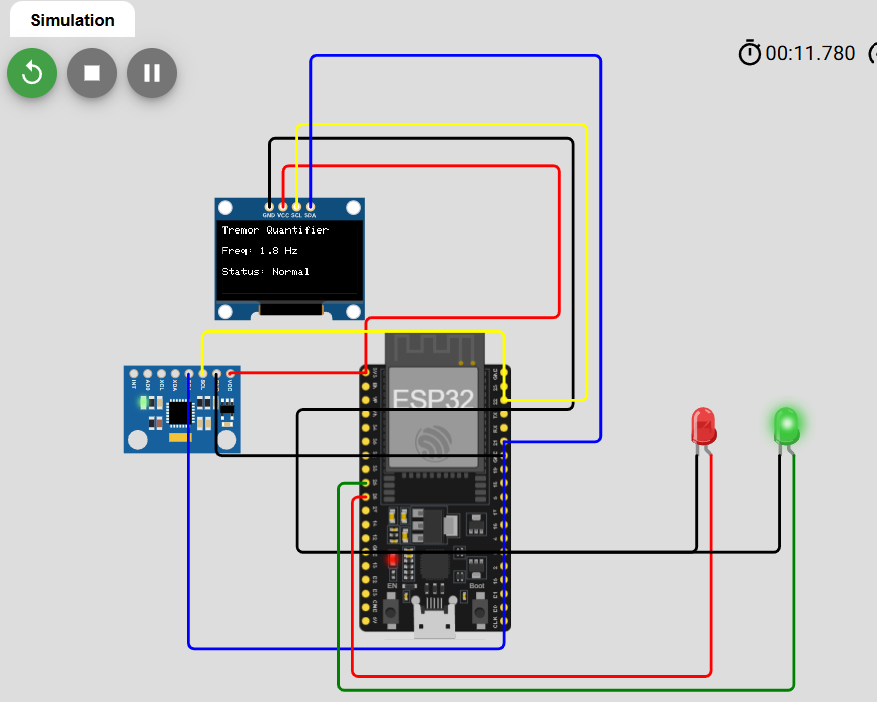

# Parkinsonian Tremor Quantifier

An embedded system prototype designed to quantify parkinsonian tremors using an **ESP32** microcontroller, an **MPU-6050** accelerometer, and an **OLED display**, powered by **Fast Fourier Transform (FFT)** signal processing.

---

## 📌 Project Overview
Parkinsonian resting tremor typically occurs within the **4–6 Hz** frequency range. This project provides a portable, cost-effective quantification tool that samples acceleration data at a strict rate of **50 Hz**, applies a **Hamming window**, and performs **FFT analysis** to isolate and measure peak tremor frequencies in real time.

### Key Features:
* **Precise Sampling:** Timed data collection at 50 Hz using microsecond intervals (`micros()`).
* **Digital Signal Processing (DSP):** Hamming windowing to reduce spectral leakage and FFT for frequency domain analysis.
* **Visual Feedback:** Real-time display of dominant frequency and status on a 0.96" OLED screen, backed by LED indicators.
* **Virtual Prototyping:** Fully testable in the Wokwi online simulator without physical hardware constraints.

---

## 🛠️ Hardware Requirements
* ESP32 Development Board (DevKit v1)
* MPU-6050 6-axis Accelerometer & Gyroscope Module
* 0.96" SSD1306 I2C OLED Display
* LEDs (Red & Green) and resistors for status indication
* Breadboard and jumper wires

---

## 📂 Repository Structure
* `/code` — Contains the C++ source code (`.ino`) and Wokwi simulation configuration (`diagram.json`).
* `/docs` — Project proposal, analysis, and schematics.

---

### 🌐 Interactive Simulation (Wokwi)
You can test and run this project right in your browser without any physical hardware:
👉 **[Open Parkinsonian Tremor Quantifier in Wokwi](https://wokwi.com/projects/478310285761660929)**

---

## 📜 License
This project is licensed under the terms of the [MIT License](LICENSE).
